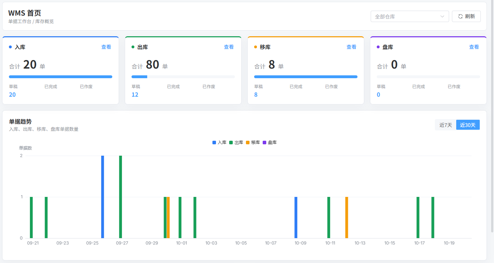

# 智云 · 企业数字化平台

> 面向制造企业的一体化数字化平台：ERP、MES、WMS、QMS、CRM、HR、OA、TMS 八大业务域，内置多租户 RBAC、工作流引擎与 AI 能力。

    



## 快速开始

前置：Docker 24+ 与 Docker Compose v2。后端、中间件、数据库迁移和首个管理员账号由 Compose 一并完成。

```bash
cd script/docker
cp .env.example .env      # 填必填口令；BOOTSTRAP_ADMIN_PASSWORD 必须 12–16 位
docker compose up -d --build
```

`db-migration` 先建 schema 并执行全部 Flyway 迁移，`bootstrap-admin` 再创建首个管理员，两者 `exit 0` 后 `server` 才启动。首次构建需编译全部 Maven 模块，请留出时间。

```bash
curl -s http://localhost:48090/actuator/health   # {"status":"UP",...}
```

```bash
cd zhicloud-ui/zhicloud-ui-admin-vue3    # 前端不在 Compose 内，需单独启动或构建后交给 nginx
pnpm install && pnpm dev                 # 默认 http://localhost，/admin-api 与 /infra/ws 代理到 127.0.0.1:48080
```

登录：租户 `智云`，账号取 `BOOTSTRAP_ADMIN_USERNAME`（默认 `zhicloud_admin`），口令为你在 `.env` 里设置的值。登录页已预填租户名与账号。

生产构建 `pnpm build:prod` 输出到 `dist-prod/`，由 nginx 托管并反代 `/admin-api` 与 `/infra/ws`（WebSocket 需带 `Upgrade`/`Connection` 头），配置见[交付手册](docs/enterprise-platform/handoff/pilot-deployment-20261020.md)。

## 功能范围

- **ERP** 财务全链路（总账/预算/合并/成本/资产/税务/资金）、采购/销售/库存、MRP、VMI
- **MES** APS 排产、生产执行、设备点检、质量、能源、PDA 报工、OEE、Andon
- **WMS** 收发存、波次拣货、FEFO、SN 追溯、3PL 计费、ABC 分析
- **QMS** IQC/IPQC/OQC、NCR、CAPA、8D、SPC、MSA、FMEA、电子签名
- **CRM** 线索/商机/合同/回款、公海池、数据权限、销售统计
- **HR** 员工、考勤、薪资、绩效、招聘、社保
- **OA** 报销、会议室、知识库、公告、日程
- **TMS** 运单、GPS 跟踪、运费结算与对账、车队运营
- **平台底座** 多租户、RBAC 按钮级权限、Flowable 工作流、代码生成、定时任务、文件服务、审计日志哈希链
- **AI（可选）** 大模型接入、RAG 混合检索、多智能体编排、数据湖仓

技术栈：JDK 21 · Spring Boot 3.5 · Spring Modulith · MyBatis-Plus · Flowable 8 · MySQL 8 · Redis 7 · PostgreSQL + pgvector · Vue 3 + Vite + Element Plus。

## 配置

完整变量见 `script/docker/.env.example`，以下为必填项：

| 变量 | 说明 |
|---|---|
| `MYSQL_ROOT_PASSWORD` / `MASTER_DATASOURCE_PASSWORD` / `SLAVE_DATASOURCE_PASSWORD` | MySQL root 与应用数据源口令，通常设成同一个值 |
| `REDIS_PASSWORD` / `POSTGRES_PASSWORD` | Redis、PostgreSQL 口令 |
| `MINIO_ROOT_PASSWORD` / `NACOS_AUTH_TOKEN` | 对象存储与配置中心，留空时 Compose 直接报错退出 |
| `BOOTSTRAP_ADMIN_USERNAME` / `BOOTSTRAP_ADMIN_PASSWORD` | 首个管理员；口令必须 12–16 位（引导脚本下限 12，登录接口上限 16） |

## 从源码开发

```bash
mvn -B -DskipTests install -T 1C          # 先把模块装进本地仓库，server 才能单独启动
export MASTER_DATASOURCE_PASSWORD='...'    # .env 只对 Compose 生效，宿主机进程不会自动加载
export SLAVE_DATASOURCE_PASSWORD='...'
export REDIS_PASSWORD='...'
cd zhicloud-server && mvn spring-boot:run  # http://127.0.0.1:48080
```

Windows 用 `$env:MASTER_DATASOURCE_PASSWORD="..."`。数据库不在 `127.0.0.1:3306` 时还要覆盖 `MASTER_DATASOURCE_URL` / `SLAVE_DATASOURCE_URL`。

## 测试

```bash
cd zhicloud-server && mvn test                         # 后端单元测试
python scripts/production/check_migration_contract.py   # 迁移契约门禁
```

## 部署

- 私有化安装、两条交付路径与必填变量：[交付手册](docs/enterprise-platform/handoff/pilot-deployment-20261020.md)
- Helm Chart 与 K8s 清单：[deploy/helm/zhicloud](deploy/helm/zhicloud)、[k8s](k8s)
- 业务试点验收记录：[business-pilot-20261020.md](docs/enterprise-platform/handoff/business-pilot-20261020.md)

## 已知限制

- **未达生产就绪**：`production_ready=false`，Go/No-Go = No-Go；第三方许可门禁需法务处置后方可对外分发。
- IM / MP 随应用构建与启动，但未纳入本次试点验收范围。
- 报表模块已接入 server（GoView 数据/项目 API）；GoView / 积木报表设计器需另部署独立服务。
- AI 能力需外部模型 Key；RAG 还需 BGE 模型文件与 pgvector，默认关闭。
- `demo-data/` 仅供演示与测试，禁止导入生产。

## 文档与贡献

[文档索引](docs/enterprise-platform/00-README.md) · [变更记录](CHANGELOG.md) · [贡献指南](CONTRIBUTING.md)。安全问题请按 [SECURITY.md](SECURITY.md) 私下报告，不要开公开 issue。

## 许可证

MIT，见 [LICENSE](LICENSE)。
