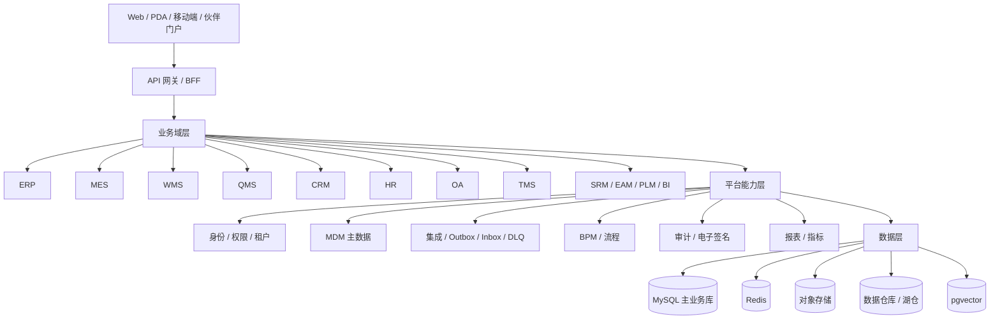

# 03 目标架构与升级方案

## 1. 设计目标

把 ZhiCloud 建设为：

> 以主数据和可靠集成为底座，以 ERP 为财务与供应链主干，以 MES/WMS/QMS 为制造执行闭环，以 CRM/HR/OA/TMS 为经营协同，面向多租户、多组织、可审计、可运营的企业数字化中台。

## 2. 架构原则

1. **单一真值源**：每个核心业务对象只有一个权威来源，其他模块只做投影或引用。
2. **模块化单体优先**：现阶段不盲目拆微服务，先硬化模块边界和事件接口。
3. **事件驱动最终一致性**：跨域写操作使用 Outbox/Inbox、幂等消费、DLQ、重放和补偿。
4. **Fail-closed 安全**：密钥缺失、证书校验失败、租户上下文缺失时拒绝启动或拒绝请求。
5. **租户优先**：所有业务表、缓存键、对象路径、事件和任务都必须带租户隔离。
6. **可审计**：关键业务动作、权限变更、财务过账、质量放行、电子签名必须可追溯。
7. **可对账**：跨域数据必须有日终/实时对账入口和差异处理流程。
8. **可运营**：从第一天定义 SLO、指标、日志、追踪、告警和值班责任。
9. **可演进**：通过 `api` 包、版本化接口、适配层和防腐层隔离变化。

## 3. 目标逻辑架构



## 4. 平台能力层设计

### 4.1 身份与租户

- 统一身份：本地账号 + OIDC/SAML + 企业微信/钉钉可选。
- MFA：管理员、财务、质量放行、生产关键操作强制。
- 权限：RBAC + 数据权限 + 字段级脱敏 + 租户隔离。
- 密钥：Vault/KMS/云 Secret Manager 作为唯一 Secret 来源。
- 审计：登录、授权、数据导出、配置变更、财务过账、质量放行。

### 4.2 MDM 主数据

权威主数据建议：

| 主数据 | 权威来源 | 主要消费方 |
|---|---|---|
| 物料 | MDM | ERP/MES/WMS/QMS |
| 客户 | CRM/MDM | ERP/TMS/BI |
| 供应商 | SRM/MDM | ERP/WMS/QMS |
| 工厂/仓库/库位 | WMS/MDM | ERP/MES/QMS |
| BOM/工艺 | PLM/MES | ERP/MES/QMS |
| 组织/人员 | HR/MDM | 全平台 |
| 科目/成本中心 | ERP | 全平台 |
| 计量单位/币种/税码 | MDM | 全平台 |

要求：

- 全局编码 + 租户内编码。
- 生命周期状态：草稿、生效、停用、归档。
- 变更版本和审批。
- 跨域映射使用 `mdm_cross_ref`，不得用字符串名称做隐式关联。

### 4.3 可靠集成

现有 V100-V107 已有 Outbox/Inbox、DLQ、租户唯一键。目标补强：

- 事件契约：事件名、版本、租户、聚合 ID、幂等键、发生时间、追踪 ID。
- 生产者：业务事务内写 Outbox。
- 消费者：Inbox 去重，处理成功/失败/重试状态。
- DLQ：可查询、可重放、可审计、可限流。
- 补偿：正向操作必须定义反向操作或人工处理入口。
- 对账：按日核对库存、应收、应付、工单、质检、运单。

### 4.4 库存单一真值

**建议以 WMS 为库存数量和库位的权威来源。**

- ERP 库存：财务和成本视角的投影。
- MES 线边库存：生产现场视角的投影或独立线边账。
- WMS 库存：数量、可用、锁定、冻结、批次、序列号、库位。
- 所有出库/入库/移库/盘点必须产生库存流水。
- 任何绕过 WMS 直接改库存的接口必须下线或加审计开关。
- 过渡期允许双写，但必须有对账任务和差异报表。

### 4.5 财务与业务单据

- 采购、销售、库存、生产、费用等业务事件生成会计事件。
- 会计事件生成凭证，必须有幂等键、期间、冲销关系。
- 期末结账、反结账、跨期调整要有权限和审计。
- 成本核算至少覆盖移动加权、标准成本、差异分析。

### 4.6 质量门禁

- IQC 未放行，收货不能入库。
- IPQC 未通过，工单不能继续流转。
- OQC 未通过，成品不能发运。
- 不合格品进入 NCR/CAPA 流程。
- 质量判定使用 BigDecimal 和明确 AQL/Ac/Re 规则。
- 电子签名记录人员、时间、动作、原因和不可篡改证据。

### 4.7 可观测性

- 指标：HTTP、JVM、连接池、Redis、DB、Outbox 滞留、Inbox 失败、DLQ、业务 KPI。
- 日志：结构化 JSON，带租户、用户、追踪 ID。
- 追踪：OpenTelemetry，关键跨域链路全链路。
- 告警：错误率、延迟、积压、连接耗尽、迁移失败、证书过期。
- SLO：可用性、P95/P99、错误预算、恢复时间。
- on-call：责任人、升级路径、演练记录。

## 5. 模块边界规则

### 5.1 目标包结构

```text
zhicloud-module-xxx/
  api/          对外接口、DTO、事件契约
  controller/   HTTP 入口
  service/      应用服务
  domain/       领域模型和规则
  dal/          仅模块内部使用
  job/          定时任务
```

### 5.2 强制规则

1. 每个业务模块必须有 `api` 包。
2. 跨模块只能 import `api` 包。
3. 禁止跨模块 import `dal`、`mapper`、`DO`。
4. 跨模块读优先走 `api` 查询接口。
5. 跨模块写优先走领域事件和幂等命令。
6. 跨模块事件必须有版本和兼容策略。
7. 模块依赖通过 CI 门禁检查，禁止新增违规依赖。

## 6. 目标部署拓扑

- Kubernetes：应用无状态化，3 副本起步，HPA、PDB、拓扑分布。
- MySQL：主从/高可用，TLS `VERIFY_IDENTITY`，备份和 PITR。
- Redis：哨兵/集群，密码和 TLS（按环境能力）。
- 消息：RocketMQ/Kafka 或数据库 Outbox 过渡方案。
- 对象存储：MinIO/S3，版本和生命周期。
- 数据仓库：Iceberg + Trino，冷热分层。
- 可观测性：Prometheus + Grafana + Loki + Tempo/Jaeger。
- 密钥：Vault/KMS/云 Secret Manager。
- 发布：迁移 Job + 滚动/金丝雀 + 自动回滚条件。

## 7. 演进路线

### 阶段 A：生产安全底座

- Secret 管理、账号清理、客户端轮换。
- TLS、K8s、备份恢复。
- 租户隔离回归。

### 阶段 B：核心业务一致性

- 库存单一真值。
- QMS 门禁。
- MES 工单状态机。
- WMS 流程闭环。
- ERP 财务过账和成本。
- CRM 回款幂等。

### 阶段 C：平台化

- 全模块 `api` 包。
- 事件契约、补偿、对账。
- SLO、告警、on-call。
- 数据治理和指标平台。

### 阶段 D：业务扩展

- SRM、EAM、PLM、BI。
- 可选 CDP、IoT、ESG。
- 多组织、多工厂、多币种、多语言。

## 8. 结论

目标架构不是“把单体拆成微服务”，而是：

> **先把模块边界、主数据、事件一致性、安全与可观测性做硬，再根据规模和团队能力决定是否拆服务。**
