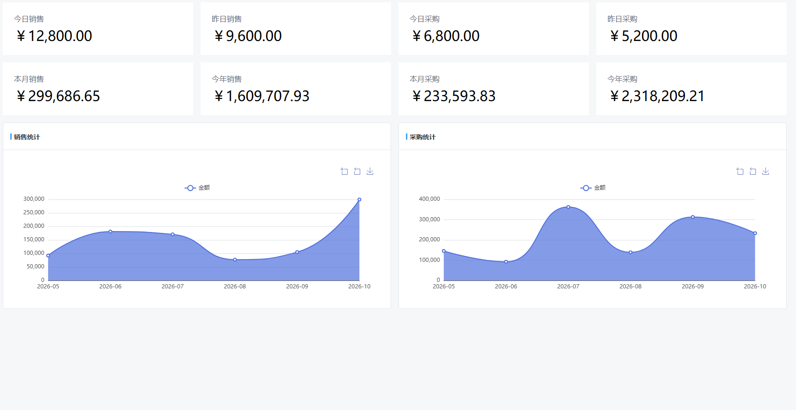
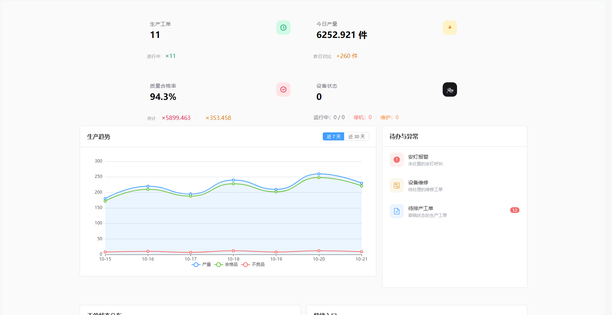
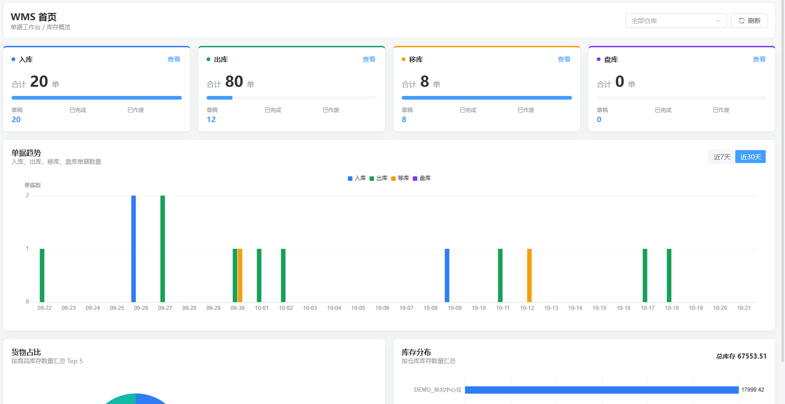
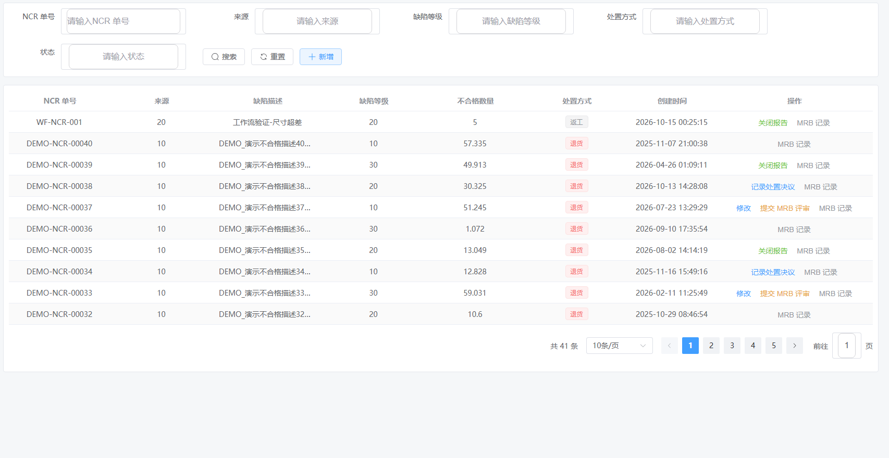
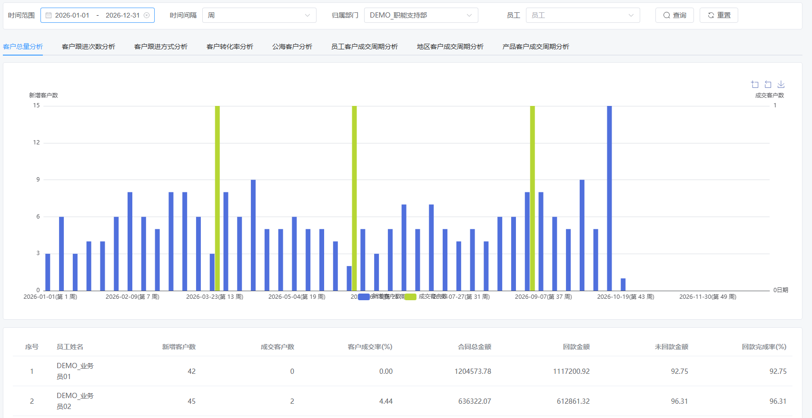
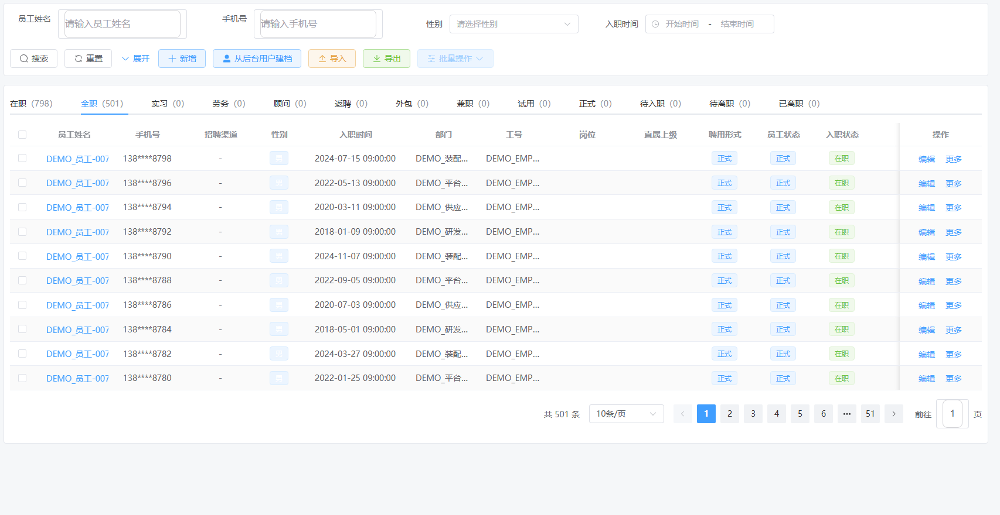
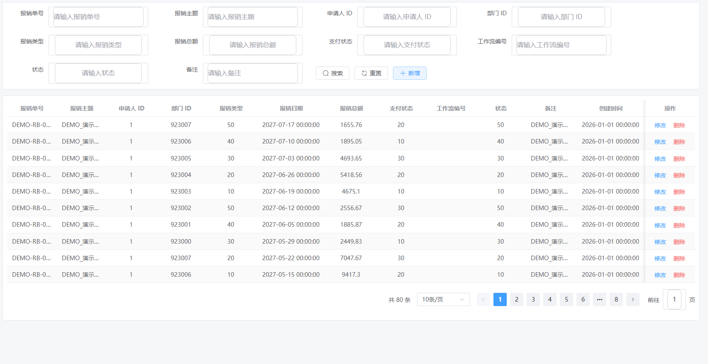
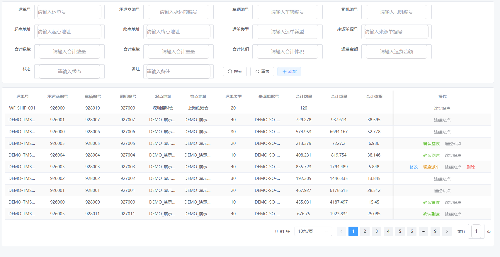

# 页面截图

以下截图来自本地沙箱（`local` profile）的演示租户，使用 1920×1080 视口截取内容区；数据为合成演示数据，不代表生产环境。

## ERP · 首页看板

## MES · 生产看板

## WMS · 仓储看板

## QMS · 不合格品处理

## CRM · 客户分析

## HRM · 员工管理

## OA · 报销管理

## TMS · 运单管理

---

截图仅用于展示界面与模块范围，不代表生产环境数据、性能或可用性承诺。
